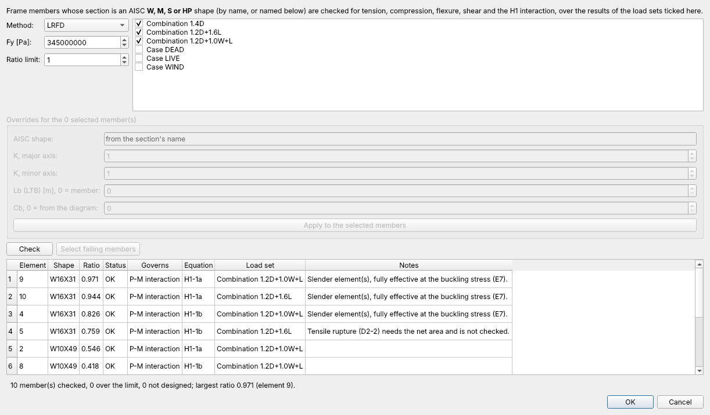
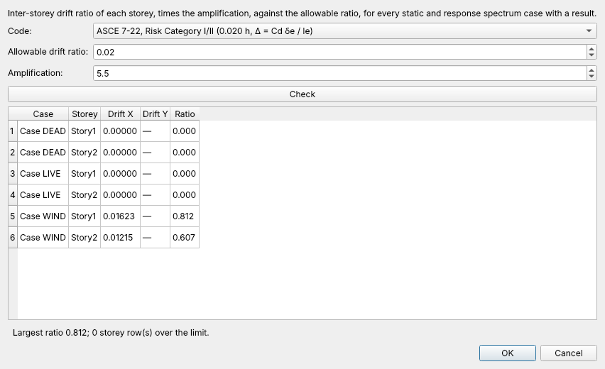

# Tutorial 1 — Diseño de un marco de acero (AISC 360-16)

[English](01-steel-frame-design.md) · **Español**

Vas a abrir un marco de acero de dos vanos y dos pisos, correr sus casos de carga,
verificar cada miembro según AISC 360-16 y las derivas de piso según ASCE 7, y ver
cómo el arriostramiento lateral de las vigas decide si las vigas de techo cumplen.

**Necesitas:** OpenSees Studio con un solver (Options → Solver) y el ejemplo
`examples/steel_frame_design.osmodel` (o corre `python examples/steel_frame_design.py`
para regenerarlo).

## 1. El modelo

File → **Open…** → `examples/steel_frame_design.osmodel`.

Es un marco 2D en el plano X-Z: vanos de 6 m, pisos de 4 m, bases empotradas.

| Miembros | Sección | Notas |
|---|---|---|
| Columnas | `W10X49` | de Define → Section Library |
| Vigas | `W16X31` | arriostradas a los tercios de la luz por las viguetas del piso |

Las secciones vienen de **Define → Section Library** (AISC v16). Conservan el
nombre del perfil (`W10X49`), y ese nombre es lo que le dice a la verificación
con qué perfil diseñar. Una sección que escribiste a mano también se puede
verificar: nombra el perfil para sus miembros en los ajustes por miembro (paso 4).

Las cargas, en **Define → Add Plain Load Pattern…** y en el árbol del modelo:

- **DEAD**: peso propio (las secciones tienen peso unitario 77 kN/m³) más
  25 kN/m sobre las vigas.
- **LIVE**: 20 kN/m sobre las vigas.
- **WIND**: 60 kN y 40 kN en el primer y segundo piso.

y tres combinaciones en **Define → Load Combinations…**: `1.4D`, `1.2D+1.6L` y
`1.2D+1.0W+L`.

## 2. Correr los casos

**Analyze → Run All Cases**. Cada caso estático corre una vez; las combinaciones
se evalúan a partir de esos resultados cuando se necesitan, así que nunca corren
por sí mismas.

## 3. Verificar los miembros

**Design → Steel Frame Check (AISC 360-16)…**

- **Method** LRFD, **Fy** 345 MPa (50 ksi), **ratio limit** 1.0. Vienen guardados
  en el ejemplo; un proyecto nuevo parte de 50 ksi en sus propias unidades.
- La lista de la derecha es lo que se envuelve: por defecto, todas las
  **combinaciones**. Marca un caso para verificarlo solo. Un caso sin resultado
  dice "no result: run it first".
- Pulsa **Check**. Una fila por miembro, la razón mayor primero: la verificación
  que gobierna (aquí la **interacción P-M**, H1-1a o H1-1b), la ecuación y el
  conjunto de cargas que la produjo.

Las vigas de techo (elementos 9 y 10) están en 0.97 y 0.94: la combinación con
viento y la de gravedad, respectivamente. Cumplen porque su ala comprimida está
arriostrada cada 2 m, que el ejemplo guarda como ajuste por miembro (`Lb = 2 m`).

> **Cómo se leen las demandas.** Cada miembro se muestrea en 25 estaciones,
> incluidas las cargas en el tramo, y se toman juntos la mayor fuerza axial, los
> mayores momentos y cortes, lo que es conservador para la interacción. Cb sale
> del diagrama de momentos del propio miembro (F1-1) salvo que lo fijes: **pon
> Cb = 1.0 en un voladizo**.

## 4. ¿Y si las vigas no estuvieran arriostradas?

1. Cierra el diálogo con **Cancel** y selecciona las cuatro vigas (haz clic en
   ellas, o Select → By Section → W16X31).
2. Abre de nuevo la verificación. El cuadro **Overrides for the 4 selected
   member(s)** queda activo.
3. Pon **Lb (LTB) = 0** (el largo del miembro, 6 m), pulsa **Apply to the selected
   members** y luego **Check**.

El pandeo lateral-torsional en 6 m —más allá de Lr, así que con la F2-3
elástica— reduce ahora la resistencia a flexión de las vigas: las cuatro suben a
1.2–1.4 y sus filas se ponen rojas. **Select failing members** cierra el diálogo
con ellas seleccionadas, listas para Assign → Frame → Section… y darles un perfil
más alto. Pulsa **OK** para guardar los ajustes en el proyecto, o **Cancel** para
olvidarlos.

Los otros ajustes por miembro: el **perfil** AISC con que verificar, **K** en cada
eje (las longitudes de pandeo son el largo del miembro por K) y **Cb**.

**Show ratios on the model** cierra el diálogo y pinta cada miembro según su
razón: azul bajo 0.5, luego turquesa, verde y naranjo hasta el límite, rojo sobre
él y gris si no se diseñó. Design → Display Steel Ratios on Model hace lo mismo
desde el menú con los ajustes guardados, y Display → Back to Model quita los
colores. File → Export → Report imprime la misma tabla.

## 5. Verificar las derivas de piso

**Design → Storey Drift Check…**

- **Code** → *ASCE 7-22, Risk Category I/II (0.020 h)*.
- **Amplification** → 5.5, el Cd / Ie de un marco especial de momento de acero:
  el análisis da derivas elásticas, ASCE 7 limita las amplificadas.
- **Check**: cada caso estático con resultado, piso por piso. WIND es el que
  importa; los casos de gravedad casi no desplazan lateralmente.

Los pisos salen de las líneas de grilla en Z (Define → Storeys…). Un modelo sin
pisos no tiene nada que verificar, y el diálogo lo dice.

## 6. Guardar

**File → Save**. Los ajustes de diseño —método, Fy, conjuntos de cargas, ajustes
por miembro y límite de deriva— se guardan en el proyecto. No cambian ningún
resultado de análisis, así que editarlos nunca te pide volver a correr.

## Lo que la verificación no hace

AISC 360-16 para perfiles **W, M, S y HP**: fluencia en tracción (la rotura
necesita el área neta), compresión (E3, E4, E7), flexión (F2, F3, F6), corte
(G2.1, G6) y H1. Los HSS, tubos, canales y ángulos aparecen como no diseñados, al
igual que un miembro cuya sección no tiene nombre AISC ni ajuste. Los números
están verificados contra los Design Examples de AISC en el
[Manual de Verificación](../verification-manual.md) (casos D-01 a D-05).
