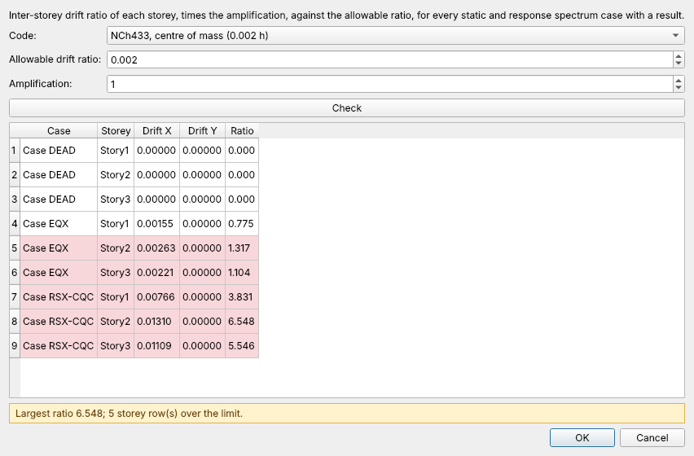

# Tutorial 2 — A building with rigid floors: modes, response spectrum and drift

**English** · [Español](02-building-spectrum-drift.es.md)

A three-storey concrete frame with a rigid diaphragm per floor: you will read its
modes, run a CQC response spectrum, and check the storey drifts against NCh433.

**You need:** a solver (Options → Solver) and `examples/building_3storey_diaphragm.osmodel`
(rebuild it with `python examples/building_3storey_diaphragm.py`).

## 1. The model

File → **Open…** → `examples/building_3storey_diaphragm.osmodel`.

- 2 × 2 bays (6 m in X, 5 m in Y), storeys of 3.5 m, columns 500 × 500 mm and
  beams 300 × 600 mm of C30 concrete (25 kN/m³).
- **Define → Storeys…**: Story1 to Story3, read from the Z grid lines, the way
  ETABS reads its story data.
- **Assign → Joint → Diaphragm…**: one rigid diaphragm per floor. Its retained
  node sits at the centre of mass (6, 5) and touches no element, so the runner
  fixes its out-of-plane DOFs. Every joint of the storey follows it in the floor's
  plane.
- **Define → Mass Source…**: DEAD (beam load plus self weight) + 0.3 LIVE,
  turned into mass and lumped at each retained node with the floor's rotational
  inertia.

## 2. Modes

**Analyze → Run All Cases** runs DEAD, EQX, the modal case and the spectrum.

The modal case uses the dense eigen solver up to 500 free DOFs, so the modes are
the same on every run and every machine (see the README, *Modal analysis:
deterministic results*). Mode 1 is the X sway: **T₁ = 0.69 s**, with **80 %** of
the mass participating. Select the modal case in **Display → Show Results Of…**
and use **Display → Animate Mode Shape** to see it.

## 3. Response spectrum

The case **RSX-CQC** combines the modes by CQC (the default for new spectrum
cases) under an approximate Eurocode 8 Type 1, soil B spectrum with
ag = 0.30 g. Mode 1 reads Sa(0.69 s) = 7.16 m/s² from it.

Spectrum results are **peaks**: positive, with their sign lost in the
combination. Reactions, member forces and shell resultants are each the
combination of every mode's static response, never derived from the combined
displacements. The **Results** panel's storey table lists the storey
displacement, drift and storey shear, combined storey by storey.

## 4. Drift check

**Design → Storey Drift Check…**

- **Code** → *NCh433, centre of mass (0.002 h)*, **Amplification** 1.
- **Check** lists every static and spectrum case with a result, storey by storey.
  A ratio above 1 is over the limit, and its row turns red.

The spectrum drifts are far above 0.002 h because this spectrum is **elastic**:
NCh433 checks the drift under the design spectrum reduced by R\*, so scale the
spectrum (or set the amplification to 1/R\*) before reading this as a
verdict. The point of the tutorial is the workflow: storeys, diaphragms, mass
source, modes, CQC and a drift limit, all on one model.

## 5. Where to go next

- **Design → Steel Frame Check** works the same way on a steel building
  ([Tutorial 1](01-steel-frame-design.md)).
- **Define → Seismic Loads (Equivalent Lateral Force)…** builds the static
  seismic pattern of ASCE 7 from the same storeys and masses.
- The [Verification Manual](../verification-manual.md) shows the SDOF and
  cantilever cases that pin the modal and spectrum solvers to closed form.
