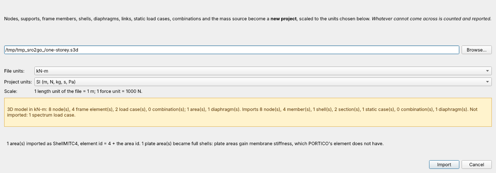

# Tutorial 3 — Traer un modelo de PORTICO a OpenSees Studio

[English](03-importing-portico.md) · **Español**

[PORTICO](https://github.com/jpreyes/portico-core) es un programa de análisis
estructural que corre en el navegador y guarda sus modelos como archivos `.s3d`.
Este tutorial abre uno aquí, en las unidades que elijas, para analizarlo con
OpenSees: secciones de fibras, materiales no lineales, tiempo-historia y el resto.

**Necesitas:** un archivo `.s3d`. La carpeta `examples/` de PORTICO trae un par de
docenas (sus tutoriales y sus casos de verificación).

## 1. Importar

**File → Import → PORTICO Model (.s3d)…**. La importación **reemplaza** el
proyecto abierto, así que primero pregunta por los cambios sin guardar, como
File → Open.

Pulsa **Browse…** y elige el archivo. El diálogo lo lee de inmediato:

- **File units**: el sistema en que están los números del archivo, según su
  etiqueta `units` (`kN-m`, `kip-in`, `lb-in`…). PORTICO nunca convierte, así que
  la etiqueta es lo único que dice qué es un "1" en el archivo. Cámbiala si está
  mal.
- **Project units**: el sistema que tendrá el proyecto nuevo. **Todo valor se
  escala a él según su dimensión**: longitudes, fuerzas, momentos, módulos, áreas,
  inercias, masas, densidades, resortes y cargas. Un archivo `kN-m` se abre por
  defecto en SI (m, N), así que sus fuerzas se multiplican por 1000 y sus
  densidades (t/m³) pasan a kg/m³. La línea **Scale** muestra los factores de
  longitud y de fuerza.
- El resumen dice qué tiene el archivo y qué tendrá el proyecto. Lo que no puede
  pasar se **cuenta** ahí ("Not imported: 1 spectrum load case"); las notas debajo
  dicen qué cambió en el camino.

Pulsa **Import**. El log repite el resumen y las notas. El proyecto todavía no
tiene archivo: **File → Save As…** lo guarda.

## 2. Qué cambió en el camino, y por qué

**Ejes locales.** PORTICO pone el eje local **y** de una viga hacia arriba;
OpenSees (aquí), el **z**. En 3D casi todo miembro queda "girado": se
intercambian su `Iz` e `Iy`, sus áreas de corte y sus liberaciones de flexión, y
el nombre de la sección termina en `(axes 2-3)` para que se vea cuáles. Las cargas
distribuidas se reproyectan sobre los ejes de OpenSees, así que una carga de
gravedad sigue siendo de gravedad. Un modelo 2D conserva sus ejes.

**Timoshenko.** Los miembros de PORTICO se deforman por corte cuando la sección
tiene áreas de corte, y estos también (un `ElasticTimoshenkoBeam`). OpenSees 3.8
no admite liberaciones ni cargas trapezoidales en ese elemento, así que un miembro
con ellas pierde su deformación por corte, y el resumen lo cuenta.

**Áreas.** Los cuadriláteros pasan a `ShellMITC4`. Una *membrana* de PORTICO gana
rigidez a flexión y una *placa*, rigidez de membrana; las notas lo dicen. Los
triángulos no tienen aquí una cáscara de 3 nodos y se cuentan.

**Pisos y enlaces.** Un diafragma pasa a diafragma rígido sobre el nodo maestro de
PORTICO; su masa se reparte entre los nodos del piso. Un enlace rígido pasa a
rigid link con su brazo de palanca; cualquier otro enlace, a equalDOF.

**Peso propio.** Es la densidad por g en las unidades del proyecto. PORTICO
siempre multiplica por 9.80665, lo que sólo es correcto en `kN-m`; para un archivo
`kip-in` las notas avisan que el peso propio del propio PORTICO es distinto.

## 3. Correr y comparar

**Analyze → Run All Cases**. Cada caso de carga estático de PORTICO pasó a un
patrón de carga más un caso estático lineal con el mismo nombre, sus
combinaciones a combinaciones, y un modelo cargado sólo con desplazamientos
impuestos (un patch test) recibió un caso propio.

PORTICO publica corridas de OpenSeesPy de cinco de sus modelos de verificación.
Importados aquí dan los mismos desplazamientos, reacciones y autovalores con error
de 1e-10: asentamiento de apoyo (1-005), enlace con excentricidad (1-010), voladizo
modal (1-014), pórtico estático (1-018) y el marco de Bathe–Wilson (1-021).
`tests/integration/test_s3d_import_run.py` repite esa comparación cuando
`PORTICO_CORE_DIR` apunta a una copia de PORTICO.

## 4. Lo que todavía no pasa

Cargas térmicas, casos de espectro de respuesta (el espectro no está en el
archivo), áreas triangulares, resortes unilaterales, acoplados y de suelo, la
masa rotacional y la excentricidad accidental de un diafragma, y el
comportamiento de cable / sólo compresión. Cada uno se cuenta en el resumen y en
el log; nunca se descarta en silencio. La lista completa está en la página de
ayuda (F1 en el diálogo).
